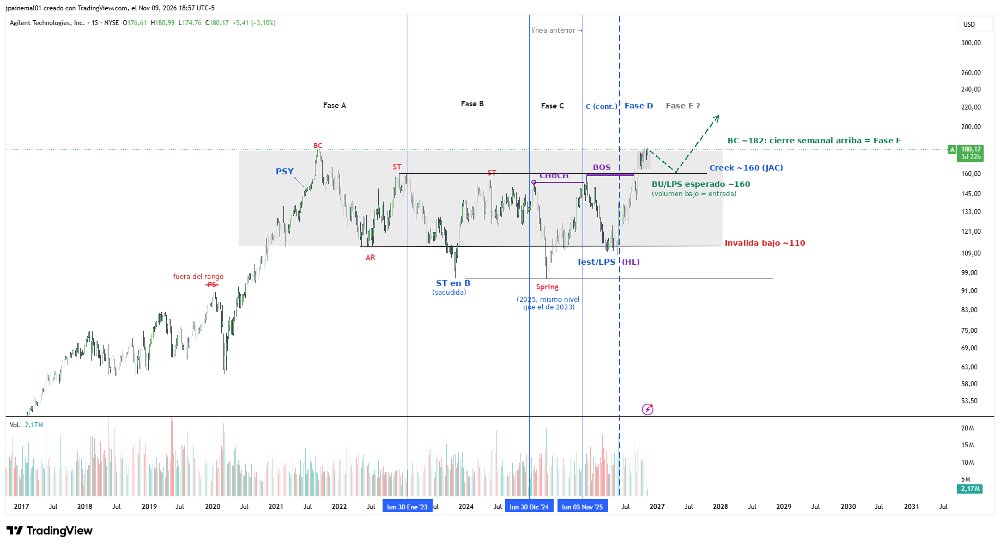

# A — Agilent Technologies

- **Gráfico:** Semanal
- **Lectura:** Reacumulación
- **Fase actual:** D/E
- **Analizado:** 2026-11-10

## Estructura

- Subida 2017–2021 y rango de ~4 años entre ~110 y ~160–182.
- Fase A: PSY (2021), BC ~182, AR ~112, ST. El PS de 2020 queda fuera del rango.
- Fase B: la caída a ~96 de 2023 es una sacudida / ST en B (no SOW).
- Fase C: Spring de 2025 (~97, mismo nivel que el mínimo de 2023).
- Fase D: Test/LPS en 2026 (~110, mínimo más alto), CHoCH ~153 y BOS ~160 (creek/JAC).

## Niveles de decisión

- Cierre semanal sobre ~182 (BC) = fase E.
- BU/LPS esperado hacia ~160 con volumen bajo.
- Bajo ~150–155 la ruptura queda en duda; bajo ~110 se invalida.

Los niveles están en [`seguimiento.csv`](../seguimiento.csv): el screener avisa cuando el precio los cruza.
