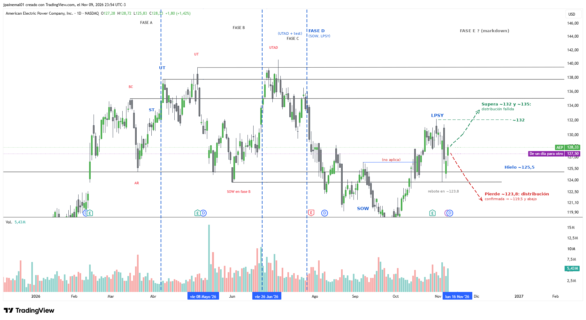

# AEP — American Electric Power

- **Gráfico:** Diario
- **Lectura:** Distribución (opción A)
- **Fase actual:** D
- **Analizado:** 2026-11-10

## Estructura

- Fase A: BC ~135, AR ~125,5 (hielo), ST de fines de marzo.
- Fase B (abril a junio): UT ~138 y ~139,5; SOW en fase B (~124).
- Fase C: UTAD ~140,5 (jun-26) y su test (~136,5).
- Fase D: rompe el hielo, SOW (~119,5 en oct) y LPSY (~132 en nov).
- Alternativa: si supera ~132 y ~135, la distribución falla.

## Niveles de decisión

- Pierde ~123,8 = distribución confirmada (objetivo ~119,5 y abajo).
- Supera ~132 y luego ~135 = distribución fallida.

Los niveles están en [`seguimiento.csv`](../seguimiento.csv): el screener avisa cuando el precio los cruza.
