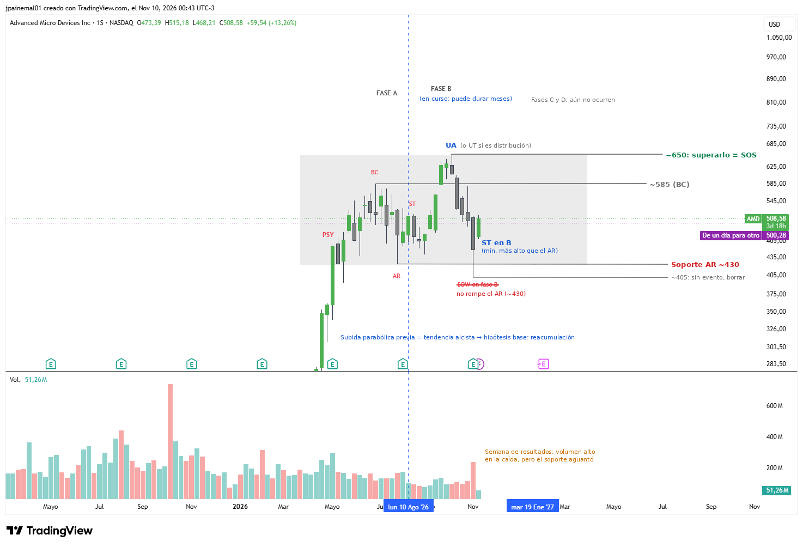

# AMD — Advanced Micro Devices

- **Gráfico:** Semanal
- **Lectura:** Reacumulación (hipótesis base)
- **Fase actual:** B
- **Analizado:** 2026-11-10

## Estructura

- Subida parabólica de ~280 a ~550 (2026).
- Fase A: PSY, BC ~585, AR ~430, ST.
- Fase B en curso: UA ~650 (UT si fuera distribución) y ST en B en nov-26 (~450, mínimo más alto que el AR).
- La caída de la semana de resultados no rompió el AR: no es SOW.

## Niveles de decisión

- Superar ~650 con volumen = SOS / fase D.
- Perder ~430 con cierre semanal = posible distribución.
- Esperar la fase C (Spring bajo ~430 o UTAD sobre ~650).

Los niveles están en [`seguimiento.csv`](../seguimiento.csv): el screener avisa cuando el precio los cruza.
