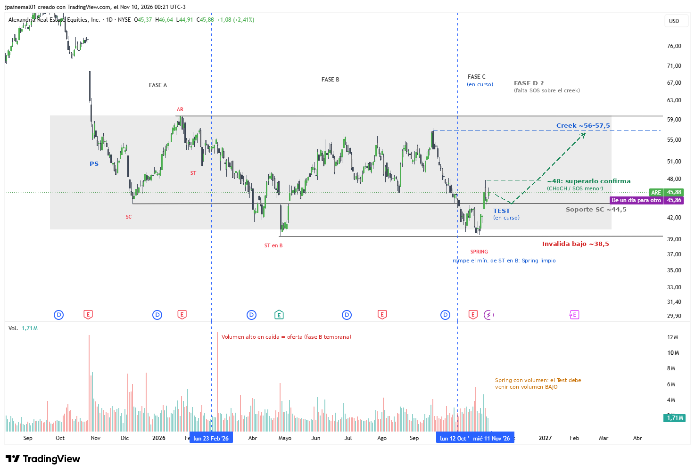

# ARE — Alexandria Real Estate

- **Gráfico:** Diario
- **Lectura:** Acumulación
- **Fase actual:** C
- **Analizado:** 2026-11-10

## Estructura

- Desplome de ~76 a ~45 (oct-25).
- Fase A: PS, SC ~44,5, AR ~59,5, ST.
- Fase B larga (feb–oct-26), máximos ~56–57,5 bajo el AR.
- Fase C: Spring de manual en oct-26 (~38,5, rompe el ST en B ~39,5) y Test en curso sobre ~44,5.

## Niveles de decisión

- Superar ~48 = CHoCH / SOS menor.
- SOS sobre el creek ~56–57,5 = fase D.
- Bajo ~38,5 se invalida.

Los niveles están en [`seguimiento.csv`](../seguimiento.csv): el screener avisa cuando el precio los cruza.
