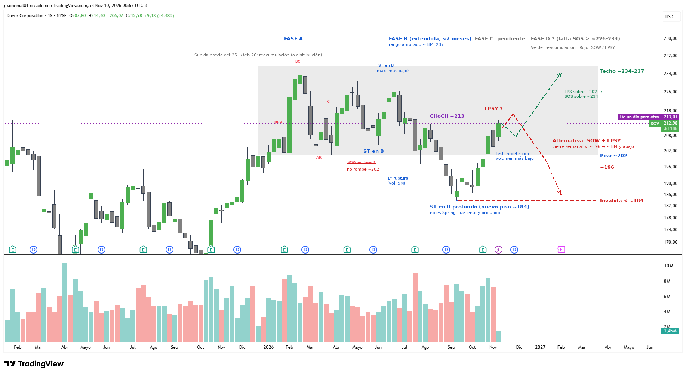

# DOV — Dover

- **Gráfico:** Semanal
- **Lectura:** Reacumulación (o distribución)
- **Fase actual:** B extendida
- **Analizado:** 2026-11-10

## Estructura

- Subida oct-25 → feb-26; PSY, BC ~237,5, AR ~201, ST (fin de la fase A en abril).
- Fase B extendida (~7 meses): ST en B, máximo más bajo de junio (~234), 1ª ruptura (9M) y ST en B profundo (~184, sep-26).
- La caída de sep-26 NO es Spring: 9 semanas abajo y ~9% de profundidad. El rango se amplía a ~184–237.
- CHoCH ~214,6 y Test reciente sobre ~201 con volumen alto.
- Alternativa: la caída fue un SOW y el rebote actual un LPSY.

## Niveles de decisión

- SOS sobre ~234 (cierre semanal).
- Cierre semanal bajo ~196 = SOW (objetivo ~184 y abajo).
- Bajo ~184 se invalida.
- Fase C pendiente: lo ideal es un Test con volumen bajo sobre ~201.

Los niveles están en [`seguimiento.csv`](../seguimiento.csv): el screener avisa cuando el precio los cruza.
