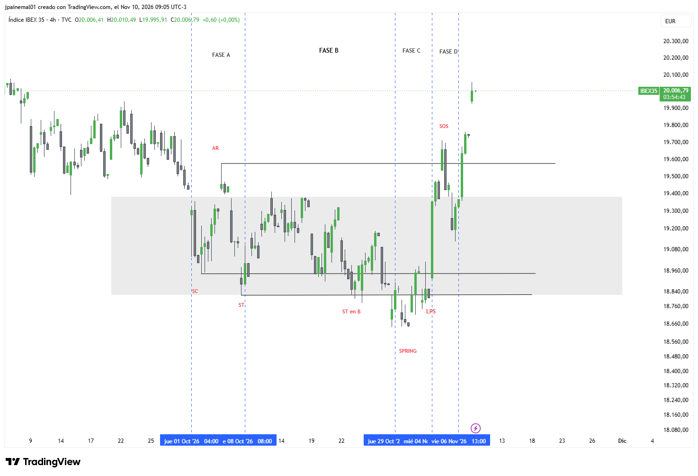

# IBEX — IBEX 35

- **Gráfico:** 4 horas
- **Lectura:** Acumulación
- **Fase actual:** E
- **Analizado:** 2026-11-10

## Estructura

- Canal bajista desde agosto; SC el 1-oct (~135M de volumen en BME:IBC).
- Fase A 1–8 oct, fase B 8–28 oct, fase C 29 oct–4 nov (Spring ~18.650), SOS 4–5 nov.
- Correcciones: el LPS del 3–4 nov es el Test del Spring; el LPS real es el retroceso del 6 nov (~19.130). Falta etiquetar la fase E.
- Creek ~19.300–19.350 (JAC) y techo del rango en el AR ~19.580.
- Volumen: usar el símbolo BME:IBC en TradingView (TVC:IBEX35 no tiene volumen).

## Niveles de decisión

- Objetivo aproximado ~20.300 (altura del rango sobre la ruptura).
- BU hacia ~19.580–19.600 debe sostenerse.
- Bajo ~18.650 (Spring) se invalida.

Los niveles están en [`seguimiento.csv`](../seguimiento.csv): el screener avisa cuando el precio los cruza.
