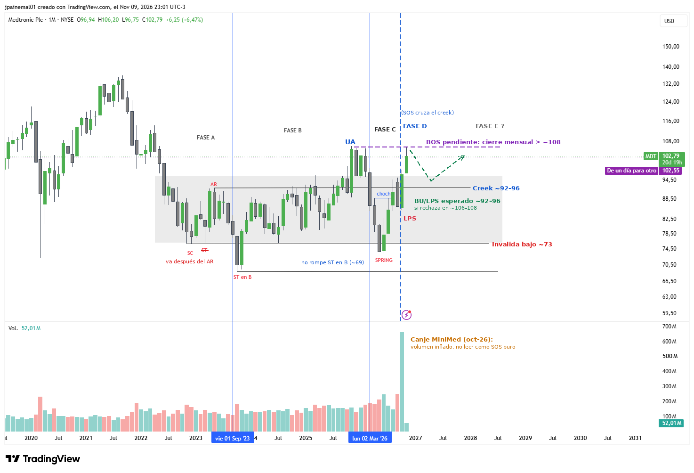

# MDT — Medtronic

- **Gráfico:** Mensual
- **Lectura:** Acumulación
- **Fase actual:** D
- **Analizado:** 2026-11-10

## Estructura

- Caída 2021–2022 y rango ~69–108.
- Fase A: SC ~76, AR ~92, ST (va después del AR).
- Fase B: ST en B ~69 (2023) y UA de 2025 hasta ~106–108.
- Fase C: Spring de mar-26 (~73; no rompe el ST en B).
- Fase D: CHoCH, LPS y SOS de oct-26 cruzando el creek ~92–96. El volumen de oct-26 está inflado por el canje de MiniMed.

## Niveles de decisión

- Cierre mensual sobre ~108 (techo del UA) = BOS y probable fase E.
- Si rechaza: BU/LPS hacia ~92–96.
- Bajo ~73 se invalida.

Los niveles están en [`seguimiento.csv`](../seguimiento.csv): el screener avisa cuando el precio los cruza.
