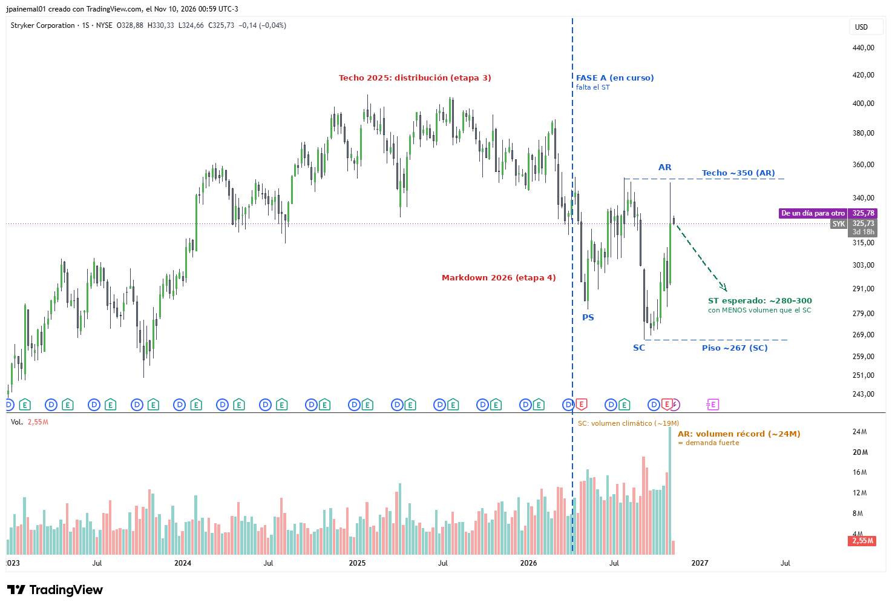

# SYK — Stryker

- **Gráfico:** Semanal
- **Lectura:** Acumulación
- **Fase actual:** A
- **Analizado:** 2026-11-10

## Estructura

- Techo 2025 = distribución (etapa 3); markdown 2026 (etapa 4) de ~390 a ~267.
- Fase A en curso: PS ~281 (abr-26), SC ~267 (sep-26, ~19M), AR ~350 (nov-26, volumen récord ~24M).
- Falta el ST. El 'Spring' que marcó el screener encaja mejor como SC.

## Niveles de decisión

- ST esperado hacia ~280–300 con menos volumen que el SC.
- Rango ~267–350; después viene una fase B que puede durar meses.

Los niveles están en [`seguimiento.csv`](../seguimiento.csv): el screener avisa cuando el precio los cruza.
